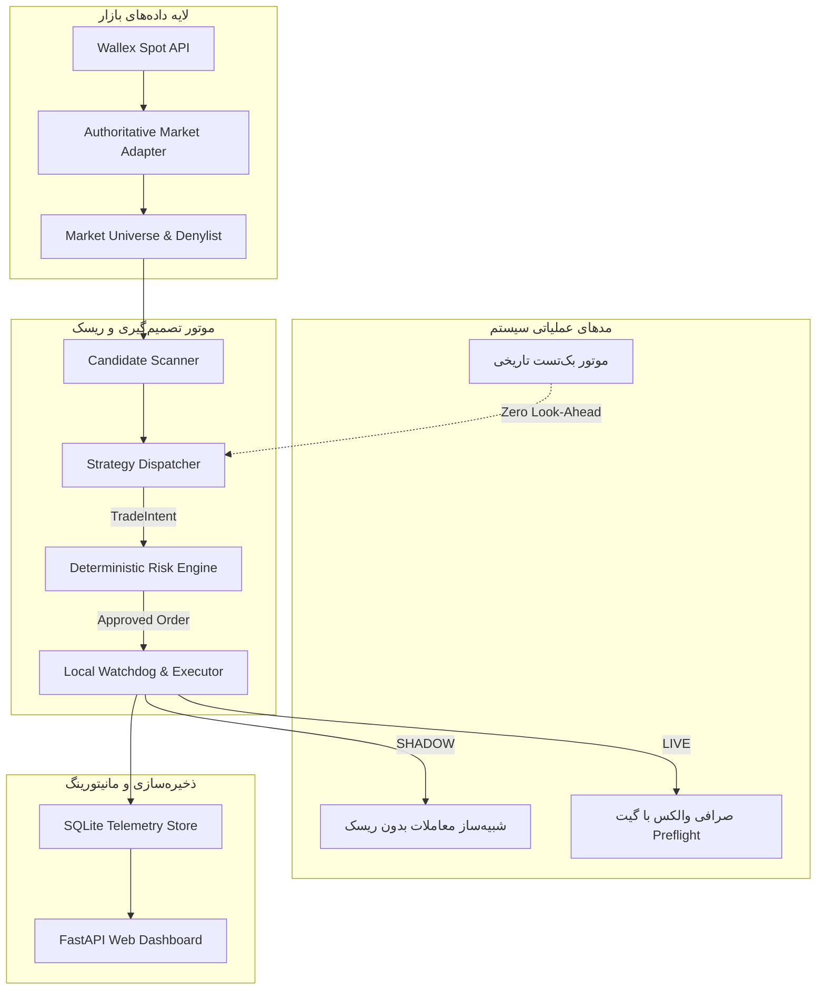

# Wallex Opportunity Agent (ربات فرصت‌یاب و معامله‌گر والکس)

[](https://www.python.org/downloads/)
[](https://fastapi.tiangolo.com)
[]()
[]()
[](LICENSE)

سیستم معاملات خودکار و مدیریت ریسک دارایی‌های اسپات در صرافی والکس (Wallex). این پروژه بر اساس معماری چندلایه، تصمیم‌گیری استراتژیک، هسته ریسک قطعی (Deterministic Risk Engine)، موتور بک‌تست تاریخی بدون نگاه به آینده (Zero Look-Ahead)، و پنل مانیتورینگ تحت وب با رابط کاربری فارسی و فونت وزیرمتن طراحی شده است.

---

## 🌟 ویژگی‌های کلیدی سامانه

1. **اسکنر پویای بازار (Dynamic Market Universe Scanner)**
   - پایش مداوم بیش از ۳۴۰ نماد اسپات فعال در والکس بر پایه تومان (TMN) و تتر (USDT).
   - فیلتر هوشمند نقدشوندگی، عمق دفتر سفارشات، شکاف قیمت (Spread Bps) و حجم معاملات ۲۴ ساعته.
   - تبدیل خودکار و دقیق قیمت نمادهای بر پایه تتر به تومان بر اساس نرخ لحظه‌ای بازار `USDTTMN`.

2. **معماری استراتژی چندگانه (Multi-Strategy Engine)**
   - استراتژی پیش‌فرض: **پولبک با فیلتر روند (Trend-Filtered Pullback)**
     - فیلتر روند تایم‌فریم ۵ دقیقه (`EMA20 > EMA50`) جهت ممانعت قاطع از ورود در روندهای نزولی.
     - شناسایی پولبک تایم‌فریم ۱ دقیقه به میانگین کوتاه‌مدت یا VWAP با تأیید کندل بازگشتی سبز.
     - ارزیابی خالص مزیت معاملاتی (Net Edge) در برابر کارمزد رفت‌وبرگشت، اسپرد و اسلیپیج.
   - استراتژی‌های قابل انتخاب در بک‌تست: `Momentum`، `Trend Following` و `Mean Reversion`.

3. **هسته ریسک قطعی و نگهبان محلی (Risk Engine & Local Watchdog)**
   - تخصیص سرمایه محافظه‌کارانه (حداکثر ۲۰٪ نقدینگی در هر معامله).
   - ممانعت قطعی از میانگین کم‌کردن در ضرر (Anti-Averaging Down).
   - پایش میلی‌ثانیه‌ای حد ضرر (Stop Loss) و حد سود (Take Profit) با اولویت محافظت از سرمایه.

4. **گیت ایمنی پیش از معامله واقعی (Preflight Safety Gate)**
   - بررسی خودکار مجوزهای دسترسی API صرافی قبل از ارسال سفارشات واقعی.
   - اعتبارسنجی لیست سیاه نمادهای غیرفعال با سیاست قطع خودکار (Fail-Closed).
   - ممانعت از ارسال سفارشات زیر حداقل ارزش مجاز صرافی (Min Notional).

5. **پنل گرافیکی و مانیتورینگ تحت وب (FastAPI Dashboard)**
   - طراحی راست‌چین (RTL) به زبان فارسی با فونت بهینه‌شده **وزیرمتن** بدون وابستگی به CDN خارجی.
   - رسم منحنی رشد دارایی (Equity Curve) با SVG خالص و مقاوم در برابر مقادیر نامعتبر یا بدون نوسان.
   - کارت‌های تحلیلی پس از معامله (Post-Mortem Analysis) برای ریشه‌یابی علت زیان معاملات.
   - کنترل دستی وضعیت سیستم (توقف ورود به معاملات، ازسرگیری، یا خروج اضطراری و نقد کردن تمام پوزیشن‌ها).

6. **آزمایشگاه بک‌تست پارامتریک (Historical Backtest Lab)**
   - شبیه‌سازی دقیق و گام‌به‌گام با داده‌های تاریخی کندل‌ها بدون نگاه به آینده (Zero Look-Ahead).
   - محاسبات مالی با کلاس `Decimal` پایتون جهت جلوگیری از خطاهای محاسباتی ممیز شناور.
   - گزارش‌گیری جامع شامل سود ناخالص، مجموع کارمزدها، سود خالص، نرخ برد (Win Rate) و حداکثر افت سرمایه (Max Drawdown).

---

## 🏛️ ساختار معماری (System Architecture)



---

## 📁 ساختار پوشه‌ها و ماژول‌ها

```text
├── src/
│   └── wallex_agent/
│       ├── domain/             # مدل‌های پایه، انواع داده TypedDict و محاسبات دقیق Decimal
│       │   ├── types.py
│       │   └── accounting.py
│       ├── strategies/         # استراتژی‌های معاملاتی و هدایت‌کننده
│       │   ├── dispatcher.py
│       │   ├── trend_filtered_pullback.py
│       │   ├── momentum.py
│       │   └── trend_following.py
│       ├── static/fonts/       # فونت‌های محلی وزیرمتن (بدون وابستگی اینترنتی)
│       ├── adapter.py          # آداپتور رسمی داده‌های بازار والکس و تبدیل نرخ
│       ├── backtest_engine.py  # موتور شبیه‌سازی و بک‌تست تاریخی کندل‌ها
│       ├── cli.py              # واسط خط فرمان برای اجرای مدهای کاری
│       ├── client.py           # کلاینت ارتباط با APIهای عمومی و خصوصی والکس
│       ├── config.py           # مدیریت و اعتبارسنجی متغیرهای محیطی
│       ├── dashboard.py        # وب‌اپلیکیشن FastAPI و تمپلیت مانیتورینگ
│       ├── decision_agent.py   # لایه واسط ارزیابی و استخراج سیگنال‌ها
│       ├── features.py         # اندیکاتورهای تکنیکال (EMA, VWAP, ATR, Resampling)
│       ├── harness.py          # حلقه هماهنگ‌کننده چرخه اجرا (Trading Harness)
│       ├── order_executor.py   # مجری ارسال و پیگیری وضعیت سفارشات
│       ├── preflight.py        # آزمون جامع ایمنی پیش از اجرای زنده
│       ├── risk_engine.py      # مدیریت ریسک، اندازه پوزیشن و سقف زیان
│       ├── scanner.py          # اسکنر و غربال‌گر فرصت‌های برتر معاملاتی
│       ├── telemetry.py        # ثبت تله‌متری و تحلیل پس از معامله در دیتابیس
│       ├── universe.py         # مدیریت سبد نمادها و اعمال لیست سیاه
│       └── watchdog.py         # نگهبان محلی حد سود/ضرر کندل‌ها
├── tests/                      # ۱۱۶ تست خودکار واحد و یکپارچه‌سازی (pytest)
├── scripts/                    # اسکریپت‌های راه‌اندازی و دیپلوی
├── logs/                       # پوشه نگهداری فایل‌های لاگ اجرایی
├── data/                       # پوشه نگهداری پایگاه داده محلی SQLite
├── Dockerfile                  # تصویر بهینه‌شده کانتینر داکر
├── docker-compose.yml          # استقرار آسان همراه با والیوم‌های داده و لاگ
├── requirements.txt            # پکیج‌ها و کتابخانه‌های مورد نیاز
└── .env.example                # نمونه فایل تنظیمات و کلیدهای امنیتی
```

---

## 🚀 راهنمای نصب و راه‌اندازی سریع

### ۱. پیش‌نیازها
- پایتون نسخه 3.10 یا بالاتر
- Git
- داکر (اختیاری برای استقرار کانتینری)

### ۲. کلون و نصب وابستگی‌ها
```bash
# دریافت مخزن
git clone https://github.com/<YOUR-USERNAME>/<YOUR-REPO-NAME>.git
cd <YOUR-REPO-NAME>

# ساخت و فعال‌سازی محیط مجازی
python -m venv .venv

# در ویندوز (PowerShell):
.\.venv\Scripts\Activate.ps1
# در لینوکس / مکینتاش:
source .venv/bin/activate

# نصب کتابخانه‌ها
pip install -r requirements.txt
```

### ۳. تنظیم متغیرهای محیطی
یک کپی از فایل `.env.example` ایجاد کرده و در `.env` ذخیره کنید:
```bash
cp .env.example .env
```
مقادیر مورد نظر خود را در `.env` ویرایش نمایید:
```ini
# کلیدهای احراز هویت صرافی والکس
WALLEX_API_KEY=your_wallex_api_key_here

# توکن امنیتی دسترسی به پنل تحت وب
DASHBOARD_ACCESS_TOKEN=your_secure_dashboard_token_here

# حالت اجرایی سیستم (shadow یا live)
MODE=shadow

# اعتبار اولیه برای محاسبات سود و زیان (تومان)
STARTING_BALANCE_TMN=5000000

# فعال‌سازی معامله زنده (فقط برای حالت Live الزامی است)
LIVE_TRADING_ENABLED=false
LIVE_PREFLIGHT_ACKNOWLEDGED=false
```

---

## 💻 دستورات اجرا (CLI Usage)

کدهای پروژه از طریق ماژول خط فرمان `wallex_agent.cli` اجرا می‌شوند:

### ۱. اجرای حالت سایه (Shadow Mode) — بدون ریسک
در این حالت، سامانه قیمت‌های لحظه‌ای بازار را دریافت کرده، سیگنال‌ها را ارزیابی و سفارشات را شبیه‌سازی می‌کند.
```bash
python -m wallex_agent.cli shadow
```
*داشبورد وب به صورت خودکار روی آدرس `http://localhost:8000` اجرا خواهد شد.*

### ۲. اجرای آزمایشگاه بک‌تست تاریخی (Backtest Mode)
شبیه‌سازی عملکرد استراتژی بر روی داده‌های تاریخی گذشته با در نظر گرفتن اصطکاک کارمزد و اسپرد:
```bash
python -m wallex_agent.cli backtest --strategy trend_filtered_pullback --cycles 50 --stop-pct 1.0 --tp-pct 2.0
```

### ۳. اجرای زنده (Live Mode)
> ⚠️ **هشدار:** معامله زنده دارایی واقعی شما را درگیر می‌کند. اجرای این حالت نیازمند تأیید صریح سه متغیر محیطی زیر در `.env` است:
> `MODE=live`، `LIVE_TRADING_ENABLED=true` و `LIVE_PREFLIGHT_ACKNOWLEDGED=true`.
```bash
python -m wallex_agent.cli live
```

---

## 📊 پنل مدیریت و مانیتورینگ تحت وب (Web Dashboard)

پس از اجرای حالت Shadow یا Live، پنل گرافیکی از طریق مرورگر در دسترس است:
- **آدرس:** `http://localhost:8000/?token=YOUR_DASHBOARD_ACCESS_TOKEN`

### قابلیت‌های پنل:
- **مانیتورینگ زنده:** نمایش موجودی نقد، ارزش کل دارایی، پوزیشن‌های باز و سود/زیان لحظه‌ای.
- **کنترل اضطراری:** دکمه‌های Pause (توقف ورود به معاملات جدید)، Resume (ازسرگیری)، و Emergency Flatten (بستن سریع تمامی پوزیشن‌های باز).
- **آزمایشگاه بک‌تست پارامتریک:** امکان تغییر درصدهای حد سود، حد ضرر، سقف زمان نگهداری، و مشاهده بلافاصله نتایج روی نمودار رشد دارایی.
- **گزارش حسابرسی و تله‌متری:** ریشه‌یابی علت زیان معاملات (اسلیپیج، کارمزد، دریفت مارکت) و کارت تفصیلی Post-Mortem.
- **تست ایمنی Preflight:** بررسی زنده مجوزها و قفل بودن سیستم در صورت وجود ریسک یا اشکال در اکانت.

---

## 🐳 اجرای کانتینری با داکر (Docker & Docker Compose)

برای استقرار پایدار در سرورهای ابری یا محلی می‌توانید از Docker Compose استفاده کنید:

```bash
# ساخت و اجرای کانتینر در پس‌زمینه
docker-compose up -d --build

# مشاهده لاگ‌های سیستم
docker-compose logs -f app

# توقف سرویس
docker-compose down
```

---

## 🧪 اجرای آزمون‌های خودکار (Automated Tests)

این پروژه دارای ۱۱۶ تست خودکار است که صحت عملکرد محاسبات مالی، هسته ریسک، استراتژی‌ها، بک‌تست و پنل کاربری را تضمین می‌کنند:

```bash
# اجرای کلیه آزمون‌ها با Pytest
pytest tests/ -v
```

خروجی تست‌ها:
```text
tests/test_accounting.py ......................... [ 21%]
tests/test_adapter.py ..........                   [ 30%]
tests/test_backtest_engine.py .........            [ 38%]
tests/test_dashboard.py ....................       [ 55%]
tests/test_harness.py ............                 [ 65%]
tests/test_order_executor.py ........              [ 72%]
tests/test_preflight.py ..........                 [ 81%]
tests/test_risk_engine.py ..........               [ 90%]
tests/test_strategy_pullback.py ..........         [ 98%]
tests/test_watchdog.py ..                          [100%]
===================== 116 passed in 8.5s =====================
```

---

## ⚖️ سلب مسئولیت (Disclaimer)

این نرم‌افزار صرفاً برای اهداف آموزشی، پژوهشی و تحقیقاتی در زمینه سیستم‌های معاملاتی الگوریتمی و هوش مصنوعی توسعه داده شده است. بازارهای مالی حاوی ریسک‌های ذاتی و نوسانات غیرقابل پیش‌بینی هستند. استفاده از این ابزار با مسئولیت کامل کاربر انجام می‌شود و هیچ‌گونه تضمینی در خصوص سودآوری قطعی وجود ندارد.

---

## 📝 مجوز (License)

پروژه تحت مجوز [MIT License](LICENSE) منتشر شده است. استفاده، تغییر و توسعه کدهای آن برای همگان آزاد است.
